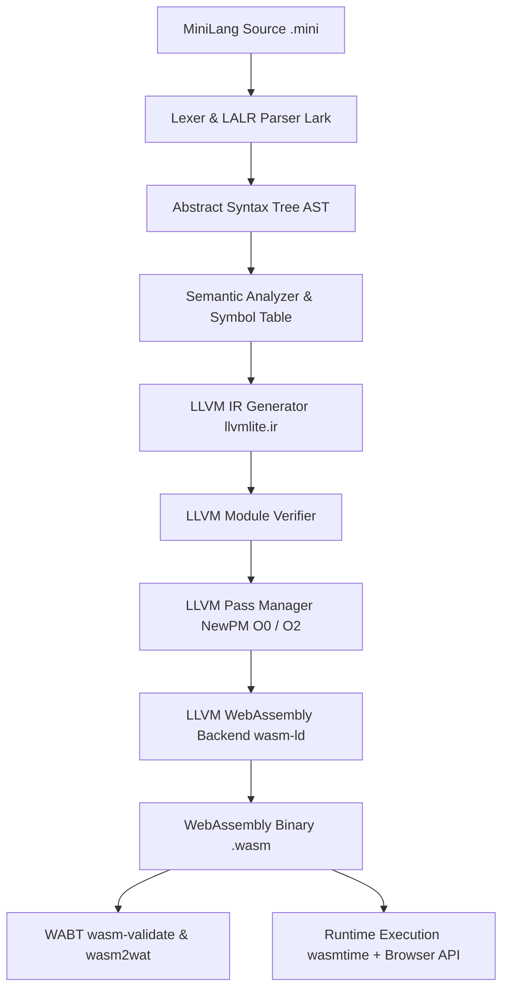

# WASM Lab: Machine-Independent Compiler Framework Targeting WebAssembly Using LLVM

[](https://github.com/)
[](https://llvm.org/)
[](https://webassembly.org/)
[](https://vitejs.dev/)

**WASM Lab** is an end-to-end, academic Compiler Construction framework and interactive web IDE. It accepts source programs written in **MiniLang** (a statically typed, imperative C-family language), performs lexical analysis and LALR parsing, validates semantic types and lexical scopes, synthesizes typed LLVM Intermediate Representation in Static Single Assignment (SSA) form, applies genuine LLVM optimization passes (`O0` vs `O2`), compiles freestanding WebAssembly binaries, validates bytecode against W3C specification tools, and executes modules across dual runtimes (`wasmtime` and native browser V8).

---

## 1. System Architecture



### The 8 Verifiable Compilation Stages

1. **Frontend**: MiniLang EBNF grammar tokenization and AST construction via Lark LALR(1) parser.
2. **Semantic Analysis**: Multi-pass symbol resolution, scope hierarchy, and strict type checking (`i32`, `bool`).
3. **LLVM IR Generation**: Programmatic synthesis of typed LLVM IR targeting `wasm32-unknown-unknown`.
4. **LLVM Verification**: Verification of dominance properties, basic block integrity, and type safety (`mod.verify()`).
5. **Optimization**: LLVM's modern Pass Manager (SROA/mem2reg, SCCP, InstCombine, DCE, SimplifyCFG).
6. **WASM Codegen**: Native LLVM freestanding WebAssembly code emission with zero libc dependencies.
7. **WABT Validation**: Official W3C specification validation (`wasm-validate`) and disassembly to readable WAT (`wasm2wat`).
8. **Runtime Execution**: Sandboxed execution in `wasmtime` and native browser WebAssembly engine.

---

## 2. Prerequisites & Environment

- **Operating System**: Windows 10/11 (with cross-platform Linux compatibility).
- **Python**: Python 3.11+ (Python 3.13 verified).
- **Node.js**: v18+ (v22.15 verified) and npm.
- **Tools Included in Repository**:
  - LLVM Clang compiler with freestanding WebAssembly target (`tools/zig-windows-x86_64-0.14.0/`).
  - WABT specification utilities (`tools/wabt-1.0.42/bin/`).

---

## 3. Quick Start (Windows PowerShell)

### 3.1 Verify Toolchain
```powershell
powershell -ExecutionPolicy Bypass -File scripts\check-toolchain.ps1
```

### 3.2 Run Automated Test Suite
```powershell
powershell -ExecutionPolicy Bypass -File scripts\test.ps1
```
Runs all 28 pytest unit/integration/acceptance tests and validates the frontend production bundle.

### 3.3 Run Empirical Benchmark
```powershell
powershell -ExecutionPolicy Bypass -File scripts\benchmark.ps1
```

### 3.4 Start Development Environment
```powershell
# Option A: One-command startup script
powershell -ExecutionPolicy Bypass -File scripts\dev.ps1

# Option B: Manual terminal startup
# Terminal 1 (Backend):
python -m uvicorn backend.app.main:app --host 127.0.0.1 --port 8000 --reload

# Terminal 2 (Frontend):
cd frontend
npm run dev
```

- **Frontend Web IDE**: [http://localhost:5173/](http://localhost:5173/)
- **Backend API & Swagger Docs**: [http://127.0.0.1:8000/docs](http://127.0.0.1:8000/docs)

---

## 4. Empirical Evaluation Summary

| Program | Optimization | Total Time (ms) | Codegen (ms) | Binary Size | Instructions (Initial -> Opt) | Return Value |
|---|---|---|---|---|---|---|
| `arithmetic.mini` | `O0` | 202.44 ms | 160.51 ms | 303 B | 10 -> 10 | **50** |
| `arithmetic.mini` | `O2` | 151.95 ms | 122.82 ms | 234 B | 10 -> 2 (-80%) | **50** |
| `conditionals.mini` | `O0` | 198.66 ms | 132.04 ms | 436 B | 25 -> 25 | **90** |
| `conditionals.mini` | `O2` | 205.77 ms | 167.59 ms | 298 B | 25 -> 6 (-76%) | **90** |
| `loops.mini` | `O0` | 174.81 ms | 135.75 ms | 434 B | 27 -> 27 | **55** |
| `loops.mini` | `O2` | 155.68 ms | 107.53 ms | 359 B | 27 -> 15 (-44%) | **55** |
| `functions.mini` | `O0` | 176.89 ms | 149.25 ms | 453 B | 20 -> 20 | **55** |
| `functions.mini` | `O2` | 177.79 ms | 140.84 ms | 360 B | 20 -> 15 (-25%) | **55** |

*Measured via monotonic high-resolution clock (`time.perf_counter()`).*

---

## 5. Viva Preparation & Academic Q&A

### Q1: Why use LLVM rather than emitting WebAssembly text or bytecode directly?
**Answer**: Direct emission tightly couples the frontend parser to the WebAssembly instruction set, violating machine independence. By compiling to LLVM IR first, the frontend benefits from LLVM's industrial optimization pipeline (dead-code elimination, loop vectorization, constant folding, register promotion). Furthermore, the same LLVM IR can target x86_64, ARM, RISC-V, or WebAssembly simply by switching the target triple.

### Q2: What makes the framework machine-independent?
**Answer**: MiniLang's AST and semantic analysis have zero hardware or architecture-specific knowledge. Code generation produces target-neutral LLVM IR. Target-specific concerns (such as stack pointers, linear memory, and calling conventions) are strictly quarantined in the backend code generation stage.

### Q3: What is LLVM IR and what is Static Single Assignment (SSA) form?
**Answer**: LLVM IR is a strongly typed, universal intermediate language. In SSA form, every register variable is assigned exactly once. This eliminates arbitrary variable redefinition and makes data-flow and dependency graphs explicit, dramatically simplifying optimizations such as constant propagation and common subexpression elimination.

### Q4: How are mutable variables handled in SSA form?
**Answer**: We use the standard `alloca`/`store`/`load` pattern. Local mutable variables are allocated in memory on the stack frame. LLVM's **SROA** (Scalar Replacement of Aggregates) / `mem2reg` pass analyzes memory access patterns and elevates stack allocations into pure SSA registers and phi nodes.

### Q5: What optimizations does WASM Lab perform?
**Answer**: In `O2`, WASM Lab executes LLVM's modern Pass Manager containing:
- **SROA / mem2reg**: Promotes stack allocations into SSA registers.
- **SCCP**: Sparse Conditional Constant Propagation evaluates constant expressions at compile time.
- **InstCombine**: Algebraic simplifications and instruction combining.
- **Dead Code Elimination (DCE)**: Prunes unused computations.
- **SimplifyCFG**: Folds redundant basic blocks and conditional branches.

### Q6: What is the difference between WAT and WASM?
**Answer**: **WASM** is the binary bytecode format (starts with `0x00 0x61 0x73 0x6D`) designed for compact transport and fast parsing by execution runtimes. **WAT** (WebAssembly Text) is the human-readable S-expression textual representation of the exact same module. WASM Lab uses WABT's `wasm2wat` to disassemble the real binary into WAT for developer inspection.

### Q7: How is untrusted code handled securely?
**Answer**: 
1. Subprocesses are run with strict argument lists without shell interpolation (`shell=False`).
2. Input size is restricted to 64 KB.
3. Subprocesses enforce strict timeouts (10s compilation, 5s runtime).
4. The generated WebAssembly binary is freestanding with zero host imports, executed in a sandboxed memory space without filesystem or network access.

---

## 6. Project Structure

```
WASM Lab/
├── README.md
├── .gitignore
├── .env.example
├── docs/
│   ├── project-proposal.md
│   ├── requirements.md
│   ├── architecture.md
│   ├── grammar.md
│   ├── llvm-design.md
│   ├── wasm-backend.md
│   ├── api-contract.md
│   ├── security.md
│   ├── testing.md
│   ├── evaluation.md
│   ├── user-guide.md
│   └── troubleshooting.md
├── examples/
│   ├── arithmetic.mini
│   ├── conditionals.mini
│   ├── loops.mini
│   ├── functions.mini
│   └── semantic-errors.mini
├── backend/
│   ├── app/
│   │   ├── main.py
│   │   ├── config.py
│   │   ├── api/
│   │   │   └── routes.py
│   │   ├── schemas/
│   │   │   ├── requests.py
│   │   │   └── responses.py
│   │   ├── compiler/
│   │   │   ├── diagnostics.py
│   │   │   ├── ast_nodes.py
│   │   │   ├── grammar.py
│   │   │   ├── parser.py
│   │   │   ├── semantic.py
│   │   │   ├── ir_generator.py
│   │   │   ├── verifier.py
│   │   │   ├── optimizer.py
│   │   │   ├── wasm_codegen.py
│   │   │   ├── wasm_validator.py
│   │   │   ├── runtime.py
│   │   │   └── pipeline.py
│   │   └── services/
│   │       └── compilation_service.py
│   ├── tests/
│   │   ├── test_acceptance.py
│   │   ├── test_api.py
│   │   ├── test_ir_generation.py
│   │   ├── test_lexer_parser.py
│   │   ├── test_optimizer.py
│   │   ├── test_runtime.py
│   │   ├── test_semantics.py
│   │   └── test_wasm_backend.py
│   └── requirements.txt
├── frontend/
│   ├── src/
│   │   ├── components/
│   │   │   ├── Navbar.tsx
│   │   │   ├── StatusBar.tsx
│   │   │   ├── ActivityRail.tsx
│   │   │   ├── FileExplorer.tsx
│   │   │   ├── Editor.tsx
│   │   │   ├── PipelineVisualizer.tsx
│   │   │   ├── ArtifactInspector.tsx
│   │   │   ├── RuntimeConsole.tsx
│   │   │   ├── SettingsModal.tsx
│   │   │   └── DemoWarning.tsx
│   │   ├── languages/
│   │   │   └── minilang.ts
│   │   ├── services/
│   │   │   └── api.ts
│   │   ├── types/
│   │   │   └── compiler.ts
│   │   ├── styles/
│   │   │   └── index.css
│   │   ├── App.tsx
│   │   └── main.tsx
│   ├── index.html
│   ├── package.json
│   ├── vite.config.ts
│   ├── tsconfig.json
│   └── tailwind.config.js
├── scripts/
│   ├── check-toolchain.ps1
│   ├── dev.ps1
│   ├── test.ps1
│   ├── benchmark.ps1
│   └── run_benchmark.py
└── tools/
    ├── zig-windows-x86_64-0.14.0/
    └── wabt-1.0.42/
```
