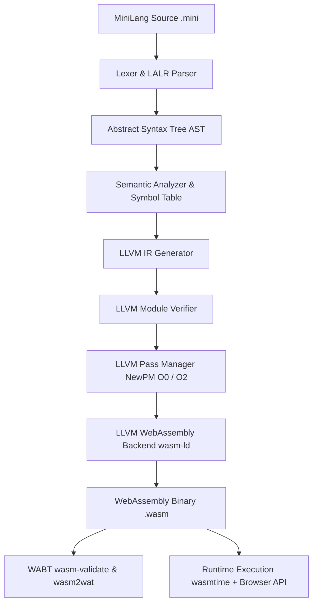

# WASM Lab System Architecture

## 1. Overview and Design Philosophy

WASM Lab is built on the fundamental principle of **machine independence**: source languages compile to a universal, target-neutral intermediate representation (LLVM IR). Optimization passes operate on this SSA (Static Single Assignment) form without target bias, and backend code generators lower the optimized IR to target machine code—in this system, WebAssembly (`wasm32-unknown-unknown`).

## 2. Compilation Stages

| Stage # | Stage Name | Implementation Module | Output Artifact | Verification Mechanism |
|---|---|---|---|---|
| 1 | **Frontend (Lex & Parse)** | `lexer.py`, `parser.py`, `grammar.py` | AST Hierarchy with source locations | Lark LALR(1) parser table |
| 2 | **Semantic Analysis** | `semantic.py` | Scope-resolved, type-checked AST | Symbol table, scope stack, type rules |
| 3 | **LLVM IR Generation** | `ir_generator.py` | Initial LLVM IR (`.ll`) | Typed LLVM builder (`llvmlite.ir`) |
| 4 | **LLVM Verification** | `verifier.py` | Validated LLVM Module | `llvm.ModuleRef.verify()` |
| 5 | **LLVM Optimization** | `optimizer.py` | Optimized LLVM IR (`.opt.ll`) | NewPM Passes (SROA, SCCP, InstCombine, DCE) |
| 6 | **WASM Codegen** | `wasm_codegen.py` | WebAssembly Binary (`.wasm`) | LLVM Clang freestanding wasm32 backend |
| 7 | **Module Validation** | `wasm_validator.py` | Readable WAT (`.wat`) | WABT `wasm-validate` & `wasm2wat` |
| 8 | **Runtime Execution** | `runtime.py` | Return code & execution metrics | `wasmtime` engine & Browser WebAssembly API |

## 3. Decoupling and Machine Independence

1. **Source Independence**: The AST and semantic analyzer have no knowledge of LLVM or WebAssembly. A second frontend (e.g., a simple functional language) could target the same AST or emit the same LLVM IR.
2. **Target Independence**: The generated LLVM IR uses standard LLVM types (`i32`, `i1`). The optimization passes (`mem2reg`, `sccp`, `instcombine`) are purely target-independent LLVM transformations.
3. **Backend Abstraction**: The backend compiler lowers the IR to freestanding WebAssembly without requiring standard system libraries or libc dependencies.
4. **Runtime Agnostic**: The resulting `.wasm` module adheres to the official W3C WebAssembly specification and executes identically in `wasmtime` (Python), Node.js, and browser engines (V8, SpiderMonkey, JavaScriptCore).
