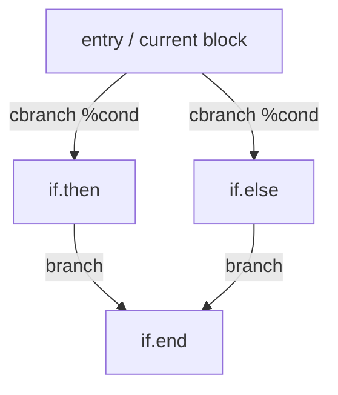
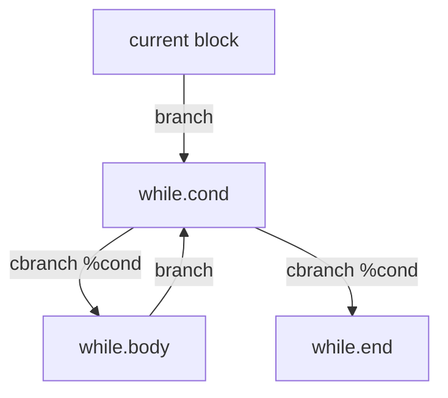

# LLVM IR Generation and Optimization Architecture

## 1. Static Single Assignment (SSA) in LLVM

LLVM IR is fundamentally structured around Static Single Assignment (SSA) form, where every register variable is defined exactly once. In source code, however, imperative variables are mutable:
```rust
let x: i32 = 10;
x = x + 5;
```

To bridge the gap between high-level mutable variables and SSA form, modern compilers use the **Memory-to-Register (mem2reg)** design pattern:
1. Every local variable is allocated on the stack via `alloca i32`.
2. Variable assignments generate `store i32 %val, i32* %x.addr`.
3. Variable evaluations generate `%val = load i32, i32* %x.addr`.
4. The LLVM **SROA** (Scalar Replacement of Aggregates) or **mem2reg** pass subsequently transforms these load/store memory sequences into pure SSA phi nodes and direct register data flows.

## 2. LLVM Type Mapping

| MiniLang Type | LLVM IR Type | Bitwidth | Notes |
|---|---|---|---|
| `i32` | `i32` | 32 bits | Standard signed integer |
| `bool` | `i1` | 1 bit | `1` = `true`, `0` = `false` |
| `void` | `void` | N/A | Function return only |

## 3. Basic Block and Control Flow Structure

The compiler constructs explicit LLVM Basic Blocks for all control flow constructs:

### 3.1 Conditional Branch (`if / else`)


### 3.2 Loop Structure (`while`)


## 4. Optimization Pipeline (NewPM)

WASM Lab implements selectable LLVM optimization using the modern Pass Manager architecture:

### 4.1 `O0` Configuration (Debug)
- Preserves all stack `alloca` structures.
- Generates unoptimized, direct linear basic blocks.
- Suitable for step-by-step debugging, source-to-IR traceability, and compiler inspection.

### 4.2 `O2` Configuration (Aggressive)
The `O2` pipeline sequentially applies canonical LLVM transformations:
1. **SROA (`add_sroa_pass`)**: Promotes stack allocations into SSA registers, eliminating redundant memory roundtrips.
2. **SCCP (`add_sccp_pass`)**: Sparse Conditional Constant Propagation evaluates constant expressions (such as `10 + 20 * 2 = 50`) at compile time.
3. **InstCombine (`add_instruction_combine_pass`)**: Rewrites algebraic identities and simplifies instruction chains.
4. **DCE (`add_dead_code_elimination_pass`)**: Identifies and removes unreachable blocks and unused instructions.
5. **SimplifyCFG (`add_simplify_cfg_pass`)**: Folds redundant conditional jumps and collapses empty blocks.
6. **Verifier (`add_verifier`)**: Validates that the transformed IR maintains valid dominance properties and well-formed SSA structures.

### 4.3 Measured Example (Constant Folding Transformation)
**Unoptimized (`O0`):**
```llvm
define i32 @"main"()
{
entry:
  %"x.addr" = alloca i32
  store i32 10, i32* %"x.addr"
  %"y.addr" = alloca i32
  store i32 20, i32* %"y.addr"
  %"x.val" = load i32, i32* %"x.addr"
  %"y.val" = load i32, i32* %"y.addr"
  %"mul" = mul i32 %"y.val", 2
  %"add" = add i32 %"x.val", %"mul"
  ret i32 %"add"
}
```

**Optimized (`O2`):**
```llvm
define i32 @main() {
entry:
  ret i32 50
}
```
All 10 initial instructions are reduced to a single immediate return!
